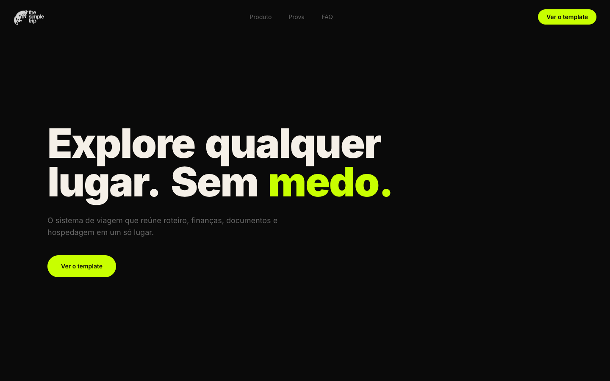

# The Simple Trip

Landing page for **The Simple Trip**, a Notion travel-planning template that brings itinerary, budget, documents and lodging into one place. Copy is in Brazilian Portuguese.



## Screenshots

| Desktop (full page) | Mobile (full page) |
| --- | --- |
|  |  |

Mobile hero: 

## Sections

NavBar, Hero, Services ("Tudo em um lugar só"), FeaturedWork (template screenshots), FAQ, Testimonials, Garantia, Pricing (Starter / Pro, Kiwify checkout) and FooterCTA.

## Stack

- Vite + React + TypeScript
- Tailwind CSS + shadcn/ui
- Deployed on Vercel (`vercel.json`)

## Develop

```bash
npm install
npm run dev      # local dev server
npm run build    # type-check + production build
npm run lint
```

## Project layout

```
src/sections/    page sections
src/components/  shared UI (shadcn)
src/lib/         tokens and utils
public/          static assets, template screenshots, thank-you page
docs/            design specs, plans, README screenshots
```
